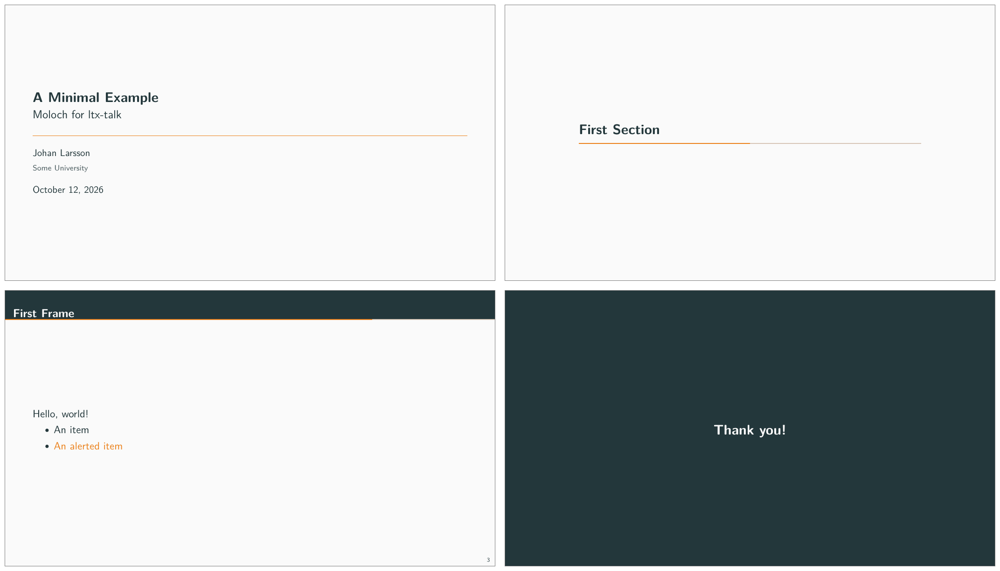

# 5  ltx-talk

> **WARNING:**
>
> This part of Moloch is experimental. It targets [ltx-talk](https://ctan.org/pkg/ltx-talk), which is itself an experimental 0.x class whose author warns that “changes may occur to almost all interfaces”. Expect changes to both the class and this theme.

`ltx-talk` is a presentation class by Joseph Wright, built around tagged PDF. That is the main reason to prefer it over Beamer: Beamer cannot currently produce properly tagged, accessible output, and `ltx-talk` is designed to.

Moloch provides its design for this class through the `moloch-talk` package.

## 5.1 Requirements

Moloch is tested with `ltx-talk` 0.6.10, which needs a LaTeX kernel from 2026-06-01 or later. With an older kernel, you will see:

    ! LaTeX Error: Class ltx-talk Error: LaTeX kernel too old.

The class supports only `pdflatex` and `lualatex`. Use `lualatex` if you want tagged output.

## 5.2 Usage

Unlike Beamer, `ltx-talk` has no theme mechanism, and its author has said that themes are deliberately not part of its design. So there is no `\usetheme` here: Moloch is loaded as an ordinary package, after the class.

``` latex
\DocumentMetadata{lang=en-US,tagging=on}
\documentclass{ltx-talk}
\usepackage{moloch-talk}

\title{A Minimal Example}
\subtitle{Moloch for ltx-talk}
\author{Johan Larsson}
\institute{Some University}
\date{\today}

\begin{document}

\maketitle

\section{First Section}

\begin{frame}
  \frametitle{First Frame}

  Hello, world!
\end{frame}

\begin{standout}
  Thank you!
\end{standout}

\end{document}
```

[](./images/example-talk-minimal.png "An example of Moloch for ltx-talk.")

An example of Moloch for `ltx-talk`.

The `\DocumentMetadata` line is required and must come before `\documentclass`. Set `lang` to the presentation’s language and use `tagging=on` to enable tagged output.

The class defaults to a 16:9 aspect ratio, while Beamer defaults to 4:3. To match the Beamer demo, use `\documentclass[10pt,aspect-ratio=4:3]{ltx-talk}`. The slides still have different physical dimensions: `ltx-talk` fixes the slide height at 100mm, while Beamer’s default 4:3 slides are 96mm high.

## 5.3 Options

You can set options when loading the package or later with `\molochset`. Changes to the palette, progress bar, and frame number settings inside a frame apply to that frame. The previous settings are restored afterward.

variant \[***light***, dark\]

Selects the light or dark version of the color palette. Unlike in the Beamer theme, you can also change the palette in the middle of a document. A change inside a frame applies to its text, header, footer, and background. The previous palette is restored after the frame.

progressbar \[***none***, head, frametitle, foot\]

Adds a progress bar at the top of the slide, directly below the frame title band, or at the bottom. The bar is not drawn on the title page, on section pages, or on standout frames.

sectionpage \[none, simple, ***progressbar***\]

Controls whether each `\section` produces a section page and whether that page carries a progress bar. The class ignores `\section` entirely when it appears inside a frame, so place it outside a frame to produce a section page.

framenumber \[***true***, false\]

Controls whether the frame number appears in the bottom right corner.

progressbar-linewidth \[*\<length\>*\] — default: 1pt

Sets the thickness of the progress bar.

titleseparator-linewidth \[*\<length\>*\] — default: 0.5pt

Sets the thickness of the rule between the title block and the author block on the title page.

## 5.4 Customization beyond these options

The option list above is deliberately short. Use the LaTeX template layer to adjust aspects of the appearance that these options do not cover. For example, to change the height of the frame title band and the font it uses:

``` latex
\geometry{tmargin = 15mm, headheight = 15mm}
\EditInstance{frametitle}{header}{font = \Large\bfseries}
```

The palette uses ordinary color definitions. To change a color:

``` latex
\definecolor{mFrametitleBg}{HTML}{4C566A}
```

See the `ltx-talk` manual for the available templates and keys.

### 5.4.1 Footer

Moloch uses its own `footer` instance, named `moloch`. Edit this instance to add content while keeping the theme’s margins and progress bar:

``` latex
\EditInstance{footer}{moloch}{element-order={author,framenumber}}
```

This places the author on the left and the frame number on the right. The footer uses short metadata when available, such as the optional argument to `\author`. Empty elements are omitted, and `framenumber=false` hides the frame number without hiding other content. You can also adjust `font`, `color`, `left-hspace`, `right-hspace`, and `separator`, or customize each element through the class’s `footer-element` instances.

Captions use smaller text and bold labels while retaining the class’s unnumbered format.

Itemize lists use the same drawn markers as the Beamer theme: a filled circle, square, and triangle for the first three nesting levels. The fourth level retains the class’s default marker. Customize the markers with `\renewcommand{\labelitemi}{...}` (or `\labelitemii` and `\labelitemiii`), or use `\item[<label>]` for an individual item.

## 5.5 Differences from the Beamer theme

Moloch for `ltx-talk` is a starting point rather than a complete port of the Beamer theme. Some differences reflect features not yet implemented; others follow from the class’s design.

The title block is centered vertically. In Beamer, it sits slightly above center in golden-ratio proportion.

Moloch for `ltx-talk` does not yet support the following features:

- The alternative color themes (`tomorrow`, `highcontrast`, `catppuccin`, `paper`). Only the default palette is available, in light and dark.
- The `titleformat` options for small caps and capitalization.
- `standout=alerted` and `standout=example`.

The class imposes the following limitations and differences from Beamer:

- **The frame title band’s height is fixed.** Long titles wrap, but the band cannot grow to fit. Increase `tmargin` and `headheight` with `\geometry` when titles need more space, and increase `headsep` to keep the extra lines inside the band. For example, for a two-line title:

  ``` latex
  \geometry{tmargin=20mm,headheight=20mm,headsep=8mm}
  ```

- **`\framesubtitle` produces no output.** The class stores the subtitle but does not currently typeset it.

- **Section pages and standout frames count as frames**, so they advance the frame number. The Beamer theme does not count them by default.

- **No predefined `alertblock`, `exampleblock`, or theorem environments.** Define theorem environments with `\newtheorem`. Blocks cannot be filled with a background color: `block` is a fixed environment in the class rather than a template.

- **No `\titlegraphic`.** The class has no such command.

- With `lualatex`, the class selects New Computer Modern Sans by file name, leaving no bold face registered. Bold text therefore silently appears in the regular weight. Either compile with `pdflatex` or set up the fonts yourself with `fontspec`.
